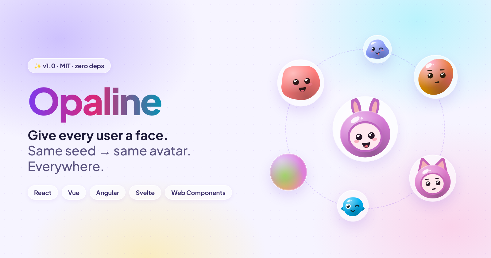
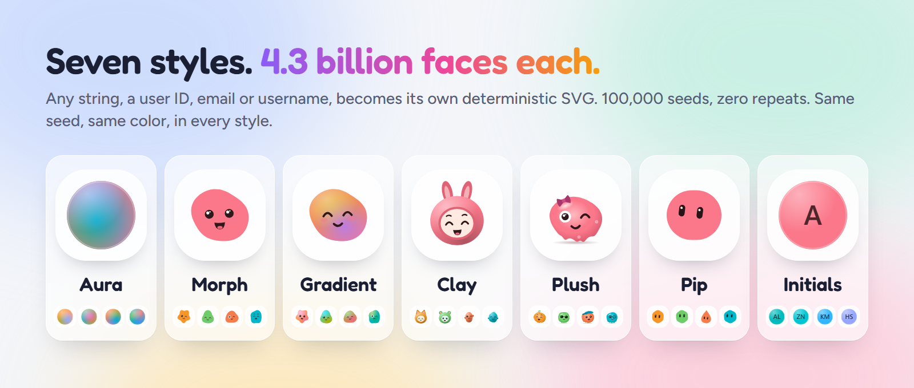
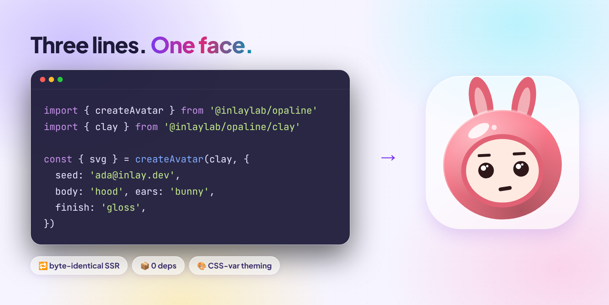
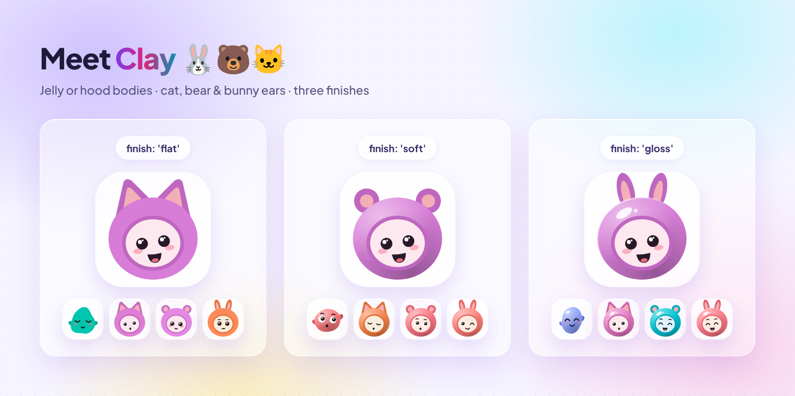

<p align="center">
  
</p>

<p align="center">
  <b>Give every user a face.</b> Seeded SVG avatars for React, Vue, Angular, Svelte and Web Components.<br>
  The same seed always gives the same avatar. MIT for code and art.
</p>

<p align="center">
  <a href="https://inlaylab.github.io/Opaline/"><b>Live demo</b></a> ·
  <a href="#quick-start">Quick start</a> ·
  <a href="#frameworks">Frameworks</a> ·
  <a href="docs/superpowers/specs/2026-11-03-avatar-design.md">Design spec</a>
</p>

<p align="center">
  <a href="https://www.npmjs.com/package/@inlaylab/opaline"></a>
  <a href="https://bundlephobia.com/package/@inlaylab/opaline"></a>
  
  <a href="LICENSE"></a>
</p>

## Why Opaline

- **Deterministic.** The same seed and options give a byte-identical SVG on the server, in every browser and in every 1.x release.
- **No hydration warnings.** Server and client produce exactly the same markup.
- **Every framework.** React (server-component safe), Vue 3, Angular (standalone, zoneless), Svelte 5 and a plain `<opaline-avatar>` custom element.
- **Zero dependencies.** The core turns a seed into an SVG string, and that's all.
- **Photo fallback.** Pass `src` and the photo is shown once it loads. If it fails, the generated avatar stays.
- **Themeable.** Change colors with CSS variables.

## Styles



| Style        | Import                       | Looks like                                                             |
| ------------ | ---------------------------- | ---------------------------------------------------------------------- |
| **Aura**     | `@inlaylab/opaline/aura`     | A glowing orb of blended color                                         |
| **Morph**    | `@inlaylab/opaline/morph`    | An organic blob with a face                                            |
| **Gradient** | `@inlaylab/opaline/gradient` | Smooth shapes with expressive faces                                    |
| **Clay**     | `@inlaylab/opaline/clay`     | Small characters: a jelly body, or a hood with cat, bear or bunny ears |
| **Initials** | `@inlaylab/opaline/initials` | The person's initials on a seeded tile with the Opaline sheen          |

## Quick start

```sh
npm i @inlaylab/opaline
```

```ts
import { createAvatar } from '@inlaylab/opaline'
import { clay } from '@inlaylab/opaline/clay'

const { svg } = createAvatar(clay, { seed: 'ada@inlay.dev', finish: 'gloss' })
```

`svg` is a plain string. Put it in HTML, save it as a file or send it in an email.



## Frameworks

| Package                     | Component                                       | Install                           |
| --------------------------- | ----------------------------------------------- | --------------------------------- |
| `@inlaylab/opaline`         | Core: seed to SVG, zero dependencies            | `npm i @inlaylab/opaline`         |
| `@inlaylab/opaline-react`   | React `<Avatar>`, server-component safe         | `npm i @inlaylab/opaline-react`   |
| `@inlaylab/opaline-vue`     | Vue 3 `<Avatar>`, SSR safe                      | `npm i @inlaylab/opaline-vue`     |
| `@inlaylab/opaline-svelte`  | Svelte 5 `<Avatar>`, runes, SSR safe            | `npm i @inlaylab/opaline-svelte`  |
| `@inlaylab/opaline-angular` | Angular `<op-avatar>`, standalone and zoneless  | `npm i @inlaylab/opaline-angular` |
| `@inlaylab/opaline-element` | `<opaline-avatar>` custom element, no framework | `npm i @inlaylab/opaline-element` |

Every component takes `seed`, `look` (the style), an optional `src` (the photo to show) and `alt`.

<details open>
<summary><b>React</b></summary>

```tsx
import { Avatar } from '@inlaylab/opaline-react'
import { clay } from '@inlaylab/opaline/clay'

;<Avatar seed={user.email} look={clay} src={user.photo} alt={user.name} />
```

</details>

<details>
<summary><b>Vue</b></summary>

```vue
<script setup>
import { Avatar } from '@inlaylab/opaline-vue'
import { clay } from '@inlaylab/opaline/clay'
</script>

<template>
  <Avatar :seed="user.email" :look="clay" :src="user.photo" :alt="user.name" />
</template>
```

If you mount several Vue apps on one page, give each one a prefix so their gradient IDs can't clash: `app.config.idPrefix = 'sidebar'`. A page with one Vue app needs nothing.

</details>

<details>
<summary><b>Svelte</b></summary>

```svelte
<script>
  import { Avatar } from '@inlaylab/opaline-svelte'
  import { clay } from '@inlaylab/opaline/clay'
</script>

<Avatar seed={user.email} look={clay} src={user.photo} alt={user.name} />
```

</details>

<details>
<summary><b>Angular</b></summary>

```ts
import { Component } from '@angular/core'
import { OpalineAvatar } from '@inlaylab/opaline-angular'
import { clay } from '@inlaylab/opaline/clay'

@Component({
  selector: 'app-user-avatar',
  imports: [OpalineAvatar],
  template: `<op-avatar [seed]="email" [look]="clay" [src]="photo" alt="Ada" />`,
})
export class UserAvatar {
  protected readonly clay = clay
  email = 'ada@inlay.dev'
  photo?: string
}
```

</details>

<details>
<summary><b>Web Component (no framework)</b></summary>

```html
<script type="module">
  import '@inlaylab/opaline-element'
</script>

<opaline-avatar
  seed="ada@inlay.dev"
  look="clay"
  finish="gloss"
  size="64"
  alt="Ada"
></opaline-avatar>
```

</details>

## Clay and finishes



```ts
createAvatar(clay, { seed: 'ada@inlay.dev', body: 'hood', ears: 'bunny', finish: 'gloss' }).svg
```

| Option   | Values                  | Default                                                                               |
| -------- | ----------------------- | ------------------------------------------------------------------------------------- |
| `body`   | `jelly`, `hood`         | Chosen by the seed                                                                    |
| `ears`   | `cat`, `bear`, `bunny`  | Chosen by the seed (hood only)                                                        |
| `finish` | `flat`, `soft`, `gloss` | `soft` for Clay. `flat` for Morph and Gradient, so their output is unchanged from 0.2 |

### Theming

| Variable      | Colors            |
| ------------- | ----------------- |
| `--avatar-c1` | The body          |
| `--avatar-c2` | The arms and ears |
| `--avatar-c3` | The hood opening  |

## Initials and shapes

New in 1.1. `initials` takes the letters from the seed: `ada.lovelace@inlay.dev` gives AL and `Zoë Nguyễn` gives ZN. Set `text` to show your own (up to 3 characters). Letters are SVG text in the system font, so every script works.

```ts
import { initials } from '@inlaylab/opaline/initials'

createAvatar(initials, { seed: 'ada.lovelace@inlay.dev', shape: 'squircle' })
createAvatar(initials, { seed: user.id, text: 'Op', palette: 'pastel' })
```

Every style takes `shape`: `circle`, `squircle`, `square` or `ellipse` (a tall 80×100 oval).

- **Aura and Initials** draw their tile in that shape. They default to `circle`.
- **Morph, Gradient and Clay** draw a soft tinted tile in that shape behind the character. Leave `shape` unset to keep them on a transparent background.

```tsx
<Avatar seed={user.email} look={clay} shape="square" />
<opaline-avatar seed="ada@inlay.dev" look="initials" shape="ellipse"></opaline-avatar>
```

Leaving `shape` unset gives exactly the 1.0 output, so upgrading changes no avatar.

## Same seed, same avatar

From 1.0, the same seed and options give a **byte-identical SVG** in every 1.x release, on the server and in every browser.

- An option set to its default gives exactly the same output as leaving it unset.
- Option order never matters.
- A checksum file in the core's tests guards this. Changing the output needs a new major version.

So you can cache avatars on a CDN, store them in a database or send them in email without them changing.

## SSR samples

Each sample renders the same two avatars on the server and checks in a browser that hydration changes nothing.

| App                  | Framework                  |
| -------------------- | -------------------------- |
| `apps/ssr-next`      | Next (App Router, RSC)     |
| `apps/ssr-angular`   | Angular SSR                |
| `apps/ssr-nuxt`      | Nuxt                       |
| `apps/ssr-sveltekit` | SvelteKit (`adapter-node`) |

Run them all with `pnpm build && pnpm e2e`.

## Development

```sh
pnpm install
pnpm dev     # docs site with live reload
pnpm check   # build, test, lint, size, package checks, e2e and perf
```

Requires Node 22 or later and pnpm.

## The name

Opaline is milky, softly glowing glass. Light goes in and comes back as color that seems to bloom from inside. That is the look we aim for: soft shapes, gentle gradients and light from one side, never hard edges.

Inlaylab names its projects after inlay materials. [Ivorie](https://github.com/Inlaylab/ivorie), our Angular UI library, is ivory: the base. Opaline is the colored glass set into it, the small bright piece that makes each surface personal. An avatar does the same job in an app.

## License

MIT, for both the code and the art.
