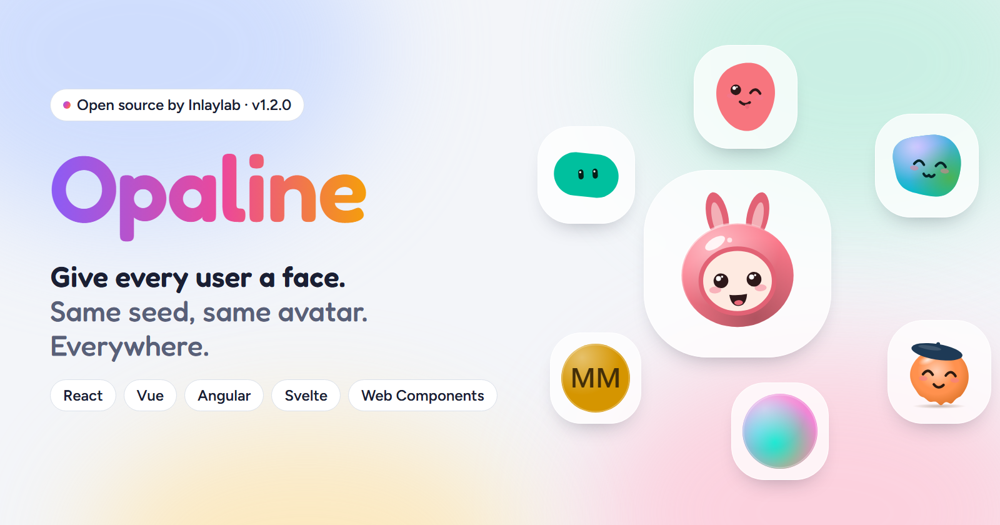
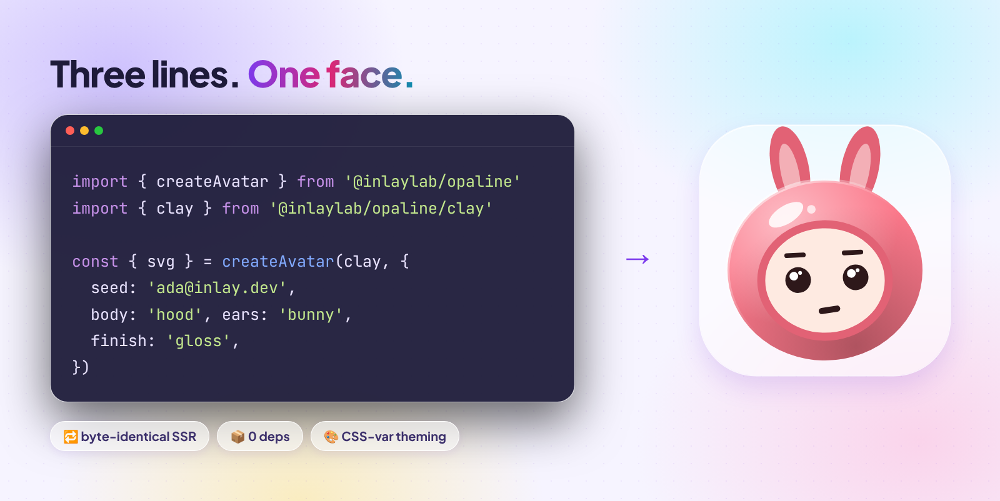
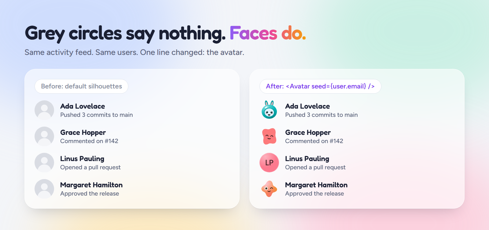
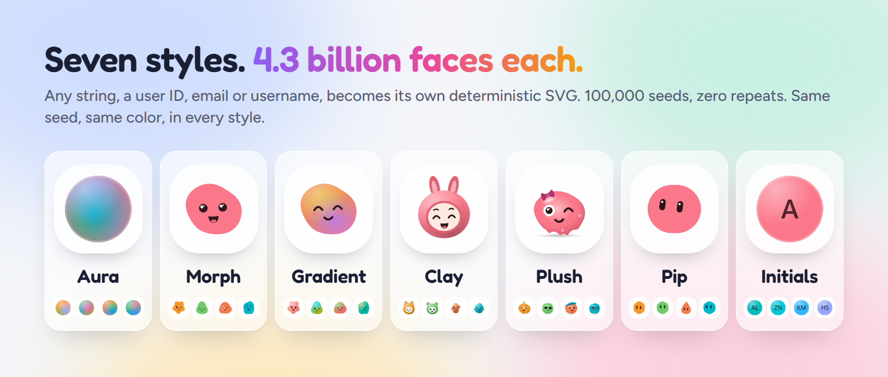
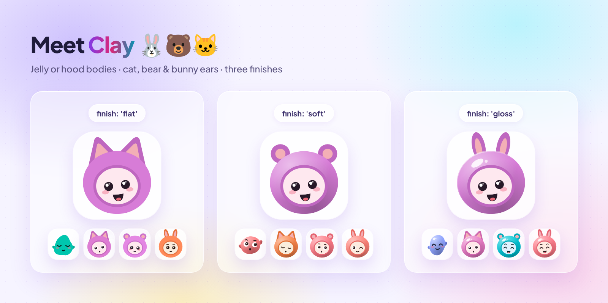
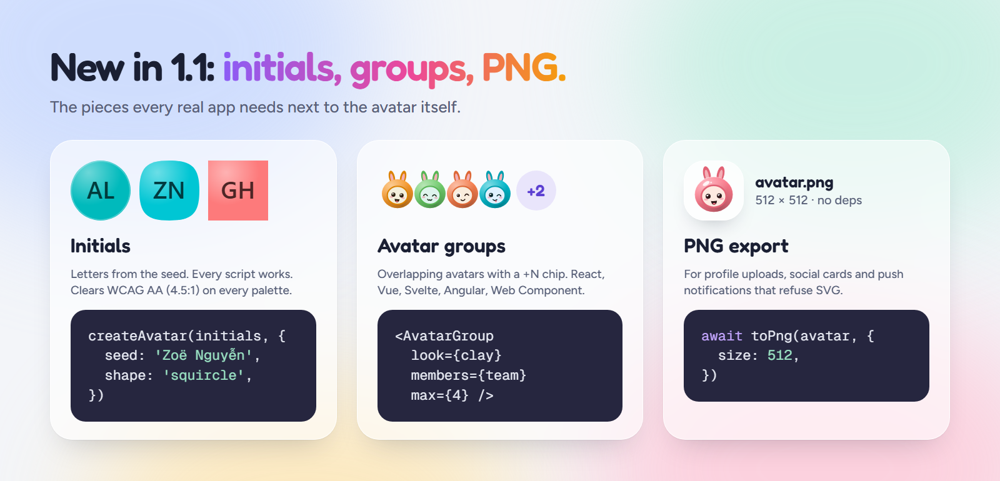
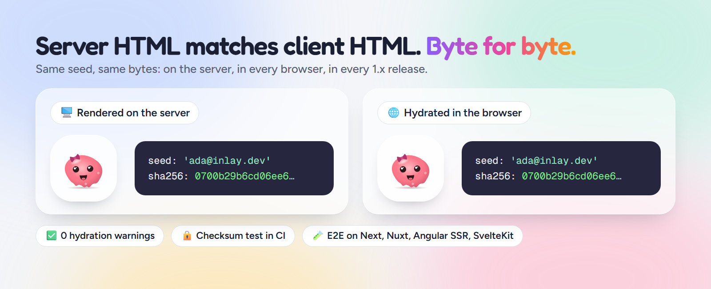

<p align="center">
  
</p>

<p align="center">
  <b>Give every user a face.</b> Seeded SVG avatars for React, Vue, Angular, Svelte and Web Components.<br>
  The same seed always gives the same avatar. MIT for code and art.
</p>

<p align="center">
  <a href="https://inlaylab.github.io/Opaline/"><b>Live demo</b></a> ·
  <a href="https://inlaylab.github.io/Opaline/playground/">Playground</a> ·
  <a href="https://inlaylab.github.io/Opaline/docs/">Docs</a> ·
  <a href="docs/guides/README.md">Guides</a> ·
  <a href="https://inlaylab.github.io/Opaline/compare/">Compare</a>
</p>

<p align="center">
  <a href="https://www.npmjs.com/package/@inlaylab/opaline"></a>
  <a href="https://bundlephobia.com/package/@inlaylab/opaline"></a>
  
  <a href="LICENSE"></a>
</p>

## What is Opaline?

Opaline turns any string (an email, a user ID, a username) into its own SVG avatar. Give it the same string again and you get the same avatar, byte for byte, on the server and in every browser.

Most users never upload a photo. Instead of a grey silhouette, they get a face that is theirs.

```ts
import { createAvatar } from '@inlaylab/opaline'
import { clay } from '@inlaylab/opaline/clay'

const { svg } = createAvatar(clay, { seed: 'ada@inlay.dev', finish: 'gloss' })
```



## Why use it



Grey circles, shared initials and random colors all fall short. Opaline fixes each one.

| Problem                                | What Opaline does                                                  |
| -------------------------------------- | ------------------------------------------------------------------ |
| Every user looks the same              | 100,000 seeds, zero repeats; up to 4.3 billion faces per style     |
| Avatars change between renders         | The same seed and options give a byte-identical SVG, forever (1.x) |
| Hydration warnings in SSR apps         | Server and client produce exactly the same markup                  |
| A different library for each framework | One core, with first-class wrappers for five frameworks            |
| Heavy dependencies and slow pages      | Zero dependencies. Import only the styles you use                  |
| A broken photo URL leaves a blank hole | Pass `src`. If the photo fails, the generated avatar stays         |

## Benefits

- **Distinct, with honest numbers.** Each style can draw about 4.3 billion faces: the seed is hashed to 32 bits. Measured with `pnpm --filter @inlaylab/opaline uniqueness`, 100,000 seeds give 100,000 different SVGs in each of the seven 1.2 styles. At 1,000,000 seeds, 99.99% are different (84 pairs share a face); at 10,000,000, 99.9%. The options add 52,000+ looks on top, so two users who share a seed's face can still be told apart by style or option.
- **Deterministic.** Cache avatars on a CDN, store them in a database or send them in email. They never change.
- **SSR safe.** No hydration warnings in Next, Nuxt, SvelteKit or Angular SSR. React support is server-component safe.
- **Tiny.** The core has zero dependencies, and each style is a separate import.
- **Themeable.** Change colors with CSS variables, with no rebuild.
- **Accessible.** Initials clear WCAG AA (4.5:1) contrast on every palette. Avatars with `alt` get `role="img"`.
- **Complete.** Photo fallback, avatar groups with a `+N` chip and PNG export are built in.
- **Open.** MIT for both the code and the art.

## Styles



| Style        | Import                       | Looks like                                                             |
| ------------ | ---------------------------- | ---------------------------------------------------------------------- |
| **Aura**     | `@inlaylab/opaline/aura`     | A glowing orb of blended color                                         |
| **Morph**    | `@inlaylab/opaline/morph`    | An organic blob with a face                                            |
| **Gradient** | `@inlaylab/opaline/gradient` | Smooth shapes with expressive faces                                    |
| **Clay**     | `@inlaylab/opaline/clay`     | Small characters: a jelly body, or a hood with cat, bear or bunny ears |
| **Plush**    | `@inlaylab/opaline/plush`    | Gummy critters, now and then wearing a hat, glasses or a flower        |
| **Pip**      | `@inlaylab/opaline/pip`      | Bold geometric shapes with two pill eyes, legible down to 24px         |
| **Initials** | `@inlaylab/opaline/initials` | The person's initials on a seeded tile with the Opaline sheen          |
| **Critters** | `@inlaylab/opaline/critters` | Soft vinyl-toy animals, nineteen of them, with jolly faces             |
| **Cosmos**   | `@inlaylab/opaline/cosmos`   | Glowing pastel space objects with colour themes                        |
| **Folk**     | `@inlaylab/opaline/folk`     | Human-like people with funny, moody or cocky faces                     |
| **Doodle**   | `@inlaylab/opaline/doodle`   | Face-only line drawings with big, expressive features                  |

A seed keeps its color in every style, so switching looks never recolors your users. Two exceptions, by design: Critters use natural animal coats (set `coat: 'palette'` to follow the seed), and Cosmos objects keep their own colours.

Not sure which to pick? Try them all in the [playground](https://inlaylab.github.io/Opaline/playground/).

## Installation

Pick the package for your framework. Each one installs the core for you.

| Framework      | Minimum version             | Install                           | Guide                                                 |
| -------------- | --------------------------- | --------------------------------- | ----------------------------------------------------- |
| React          | React 18                    | `npm i @inlaylab/opaline-react`   | [React guide](docs/guides/react.md)                   |
| Vue            | Vue 3.5                     | `npm i @inlaylab/opaline-vue`     | [Vue guide](docs/guides/vue.md)                       |
| Angular        | Angular 20 (`>=20.0.0 <23`) | `npm i @inlaylab/opaline-angular` | [Angular guide](docs/guides/angular.md)               |
| Svelte         | Svelte 5.20                 | `npm i @inlaylab/opaline-svelte`  | [Svelte guide](docs/guides/svelte.md)                 |
| Web Components | Any modern browser          | `npm i @inlaylab/opaline-element` | [Web Components guide](docs/guides/web-components.md) |
| No framework   | None                        | `npm i @inlaylab/opaline`         | [Quick start](#quick-start)                           |

The packages are `@inlaylab/opaline-react`, `-vue`, `-angular`, `-svelte`, `-element` and the core `@inlaylab/opaline`. They ship as ES modules. Node 22 or later is needed to develop in this repo.

## Quick start

Every component takes `seed`, `look` (the style), an optional `src` (the photo to show) and `alt`. Every package also has a group component: see [Avatar groups](#avatar-groups).

<details open>
<summary><b>React</b></summary>

```tsx
import { Avatar } from '@inlaylab/opaline-react'
import { clay } from '@inlaylab/opaline/clay'

;<Avatar seed={user.email} look={clay} src={user.photo} alt={user.name} />
```

</details>

<details>
<summary><b>Vue</b></summary>

```vue
<script setup>
import { Avatar } from '@inlaylab/opaline-vue'
import { clay } from '@inlaylab/opaline/clay'
</script>

<template>
  <Avatar :seed="user.email" :look="clay" :src="user.photo" :alt="user.name" />
</template>
```

If you mount several Vue apps on one page, give each one a prefix so their gradient IDs can't clash: `app.config.idPrefix = 'sidebar'`. A page with one Vue app needs nothing.

</details>

<details>
<summary><b>Svelte</b></summary>

```svelte
<script>
  import { Avatar } from '@inlaylab/opaline-svelte'
  import { clay } from '@inlaylab/opaline/clay'
</script>

<Avatar seed={user.email} look={clay} src={user.photo} alt={user.name} />
```

</details>

<details>
<summary><b>Angular</b></summary>

```ts
import { Component } from '@angular/core'
import { OpalineAvatar } from '@inlaylab/opaline-angular'
import { clay } from '@inlaylab/opaline/clay'

@Component({
  selector: 'app-user-avatar',
  imports: [OpalineAvatar],
  template: `<op-avatar [seed]="email" [look]="clay" [src]="photo" alt="Ada" />`,
})
export class UserAvatar {
  protected readonly clay = clay
  email = 'ada@inlay.dev'
  photo?: string
}
```

</details>

<details>
<summary><b>Web Component (no framework)</b></summary>

```html
<script type="module">
  import '@inlaylab/opaline-element'
</script>

<opaline-avatar
  seed="ada@inlay.dev"
  look="clay"
  finish="gloss"
  size="64"
  alt="Ada"
></opaline-avatar>
```

</details>

<details>
<summary><b>Plain JavaScript (core)</b></summary>

```ts
import { createAvatar } from '@inlaylab/opaline'
import { clay } from '@inlaylab/opaline/clay'

const { svg } = createAvatar(clay, { seed: 'ada@inlay.dev' })
```

`svg` is a plain string. Put it in HTML, save it as a file or send it in an email.

</details>

## Customize

### Clay and finishes



```ts
createAvatar(clay, { seed: 'ada@inlay.dev', body: 'hood', ears: 'bunny', finish: 'gloss' }).svg
```

| Option   | Values                                 | Default                                                                                  |
| -------- | -------------------------------------- | ---------------------------------------------------------------------------------------- |
| `body`   | `jelly`, `hood`, `ghost`               | Chosen by the seed (`ghost` only when set)                                               |
| `ears`   | `cat`, `bear`, `bunny`, `fox`, `mouse` | Chosen by the seed (hood only; `fox` and `mouse` only when set)                          |
| `finish` | `flat`, `soft`, `gloss`, `gummy`       | `soft` for Clay and Critters, `flat` for Morph, Gradient and Pip (Plush uses `material`) |

Any option you set fixes that part of the avatar. The seed fills in the rest.

### Plush and Pip

```ts
import { plush } from '@inlaylab/opaline/plush'
import { pip } from '@inlaylab/opaline/pip'

createAvatar(plush, { seed: 'ada@inlay.dev', accessory: 'beret' })
createAvatar(pip, { seed: 'ada@inlay.dev', form: 'heart', finish: 'gloss' })
```

| Option      | Values                                                                                                                                       | Default                                                                      |
| ----------- | -------------------------------------------------------------------------------------------------------------------------------------------- | ---------------------------------------------------------------------------- |
| `accessory` | `none`, `beret`, `cap`, `beanie`, `glasses`, `shades`, `flower`, `sprout`, `bow`, `star`; 1.3: `pumpkin`, `party`, `headphones`, `crown`     | Chosen by the seed (Plush; the 1.3 hats only when set). Eyewear needs a face |
| `form`      | `circle`, `squircle`, `triangle`, `hexagon`, `diamond`, `heart`, `drop`, `pill`, `dome`; 1.3: `star`, `clover`, `shield`, `octagon`, `ghost` | Chosen by the seed (Pip; the 1.3 forms only when set)                        |

Plush takes `mood`, `expression` and `family` like Morph, and `material`: `gummy` (its 1.2 look, the default), `flat` or `soft`. Plush ignores `finish`, as in 1.2, so a finish shared across looks never changes it. Pip takes `finish` (`flat` by default) and has pill eyes instead of expressions.

### New in 1.3

Everything new is opt-in: every 1.2 seed and option set renders the same bytes in 1.3.

```ts
import { critters } from '@inlaylab/opaline/critters'
import { cosmos } from '@inlaylab/opaline/cosmos'
import { folk } from '@inlaylab/opaline/folk'
import { doodle } from '@inlaylab/opaline/doodle'

createAvatar(critters, { seed, animal: 'owl', coat: 'palette', finish: 'gummy' })
createAvatar(cosmos, { seed, object: 'rocket', tone: 1, shape: 'squircle' })
createAvatar(folk, { seed, scheme: 'sepia', mood: 'attitude', shape: 'circle' })
createAvatar(doodle, { seed, scheme: 'duotone', expression: 'smug' })
createAvatar(morph, { seed, title: 'Ada', status: 'away' }) // reads "Ada (away)"
```

- **Critters**: `animal` (19), `coat` (`natural` or `palette`), `finish`, `mood`, `expression`. Faces are jolly unless you set a mood.
- **Cosmos**: `object` (15), `tone` (the colour theme), `shape` (a night-sky tile). The face never recolours.
- **Folk** and **Doodle**: `scheme` (`natural`, `bare`, `sepia`, `greyscale`, `duotone`, `muted`, `electric`, `inverted`, `pastel`, `bold`, `sunrise`), their own `expression` and `mood` (`happy`, `playful`, `attitude`, `moody`, `surprised`), and `shape` (`square` by default, or `none`). Folk defaults to `duotone`, Doodle to `natural`; `duotone` takes the seed's palette hue. With `shape: 'none'` the background is transparent, and `inverted` and `electric` draw light lines meant for a dark page.
- **Every style**: `status` (`online`, `away`, `busy`, `offline`) draws a badge, not below 20px. With `title` or `alt` the label names it (`Ada (away)`), even below 20px; without them the status is not announced. `finish: 'gummy'` on Morph, Gradient, Pip, Clay and Critters. Eight more expressions (`starry`, `love`, `laugh`, `cool`, `nice`, `smug`, `yawn`, `wow`) by name. Gradient takes `form` for its own smooth outlines, Morph three more `family` values (`star`, `drop`, `bloom`).

Bundle size grew in 1.3: shared faces, the gummy finish, Gradient forms and the status badge ship with every style. Core + Morph is 6.6 KB gzipped (4.9 KB in 1.2). Making them optional is planned for 1.4 (see the [roadmap](ROADMAP.md)).

### Initials and shapes



`initials` takes the letters from the seed: `ada.lovelace@inlay.dev` gives AL and `Zoë Nguyễn` gives ZN. Set `text` to show your own (up to 3 characters). Letters are SVG text in the system font, so every script works.

```ts
import { initials } from '@inlaylab/opaline/initials'

createAvatar(initials, { seed: 'ada.lovelace@inlay.dev', shape: 'squircle' })
createAvatar(initials, { seed: user.id, text: 'Op', palette: 'pastel' })
```

Every style takes `shape`: `circle`, `squircle` or `square`.

- **Aura and Initials** draw their tile in that shape. They default to `circle`.
- **Morph, Gradient, Clay, Plush, Pip and Critters** draw a soft tinted tile in that shape behind the character. Leave `shape` unset for a transparent background.
- **Cosmos** sits on a night-sky tile in that shape.
- **Folk and Doodle** default to `square`; `none` drops the tile.

### Theming

Colors come out as CSS variables, so you can restyle avatars without rebuilding them.

| Variable                               | Colors                                             |
| -------------------------------------- | -------------------------------------------------- |
| `--avatar-c1`                          | The body                                           |
| `--avatar-c2`                          | The arms and ears (Clay), the gummy centre (Plush) |
| `--avatar-c3`                          | The hood opening (Clay)                            |
| `--avatar-fg`                          | The Initials letters                               |
| `--avatar-ring`                        | The ring between grouped avatars                   |
| `--avatar-more-bg`, `--avatar-more-fg` | The `+N` chip in a group                           |

## Avatar groups

Overlapping avatars with a `+N` chip for everyone past `max`. Members are seeds, or `{ seed, src, alt }` for a photo and a name.

```tsx
import { AvatarGroup } from '@inlaylab/opaline-react' // also in -vue and -svelte

;<AvatarGroup look={clay} members={team.map((u) => u.email)} max={4} alt="Project members" />
```

```html
<opaline-avatar-group look="clay" size="40" max="4" alt="Project members">
  <opaline-avatar seed="ada@inlay.dev"></opaline-avatar>
  <opaline-avatar seed="grace@inlay.dev"></opaline-avatar>
  <opaline-avatar seed="linus@inlay.dev"></opaline-avatar>
</opaline-avatar-group>
```

Angular: `<op-avatar-group [members]="people" [look]="clay" max="4" />`. Avatars default to 40px.

## PNG export

For places that take no SVG, such as profile photo uploads, social cards and push notifications.

```ts
import { forRaster, toPng } from '@inlaylab/opaline/png'

// Browser: no dependencies. Returns a Blob.
const png = await toPng(createAvatar(clay, { seed }), { size: 512 })

// Server: bake the colors in, then use a rasterizer such as @resvg/resvg-js.
const buffer = new Resvg(forRaster(createAvatar(clay, { seed }), { size: 512 })).render().asPng()
```

Pass `vars: { '--avatar-c1': '#7c3aed' }` to bake theme colors into the image.

## Same seed, same avatar



The same seed and options give a **byte-identical SVG** in every 1.x release, on the server and in every browser.

- An option set to its default gives exactly the same output as leaving it unset.
- Option order never matters.
- A checksum test in the core guards this. Changing the output needs a new major version.
- One exception, made on purpose: 1.1.1 darkens the Initials letters, which were as low as 1.9:1 contrast on 1.1.0's bright tiles. Only the `<text>` color changed, and only for non-pastel palettes.

SSR samples render the same avatars on the server and check in a browser that hydration changes nothing: `apps/ssr-next`, `apps/ssr-angular`, `apps/ssr-nuxt` and `apps/ssr-sveltekit`. Run them with `pnpm build && pnpm e2e`.

## The site

[inlaylab.github.io/Opaline](https://inlaylab.github.io/Opaline/) is built with Astro from `apps/docs`.

- **Home.** Type a name and watch five styles redraw it. Browse demos of real product screens and a gallery of 100 seeds.
- **[Playground](https://inlaylab.github.io/Opaline/playground/).** Pick a style, colors and shape, then copy the code for your framework or download SVG and PNG. Every setting lives in the address, so you can share a link to an exact avatar: [`?seed=grace+hopper&style=initials&shape=squircle`](https://inlaylab.github.io/Opaline/playground/?seed=grace+hopper&style=initials&shape=squircle).
- **[Docs](https://inlaylab.github.io/Opaline/docs/).** Step-by-step setup for every framework.
- **[Compare](https://inlaylab.github.io/Opaline/compare/).** How Opaline stacks up against DiceBear and Boring Avatars.

## Development

```sh
pnpm install
pnpm dev     # build the packages, then run the docs site with live reload
pnpm check   # build, test, lint, size, package checks, e2e and perf
```

Requires Node 22 or later and pnpm. Read [CONTRIBUTING.md](CONTRIBUTING.md) before you open a pull request: it covers the output promise, golden files, size budgets and changesets.

## Project

- [Changelog](CHANGELOG.md): every release, every package.
- [Roadmap](ROADMAP.md): what comes in 1.4 and 2.0.
- [Contributing](CONTRIBUTING.md) and the [code of conduct](CODE_OF_CONDUCT.md).
- [Security policy](SECURITY.md): report a vulnerability privately, not in an issue.

## The name

Opaline is milky, softly glowing glass. Light goes in and comes back as color that seems to bloom from inside. That is the look we aim for: soft shapes, gentle gradients and light from one side, never hard edges.

## Support

Opaline is free and MIT licensed. If it saves you time, you can [buy me a coffee](https://buymeacoffee.com/bhavikbhensajaliya).

## License

MIT, for both the code and the art.
