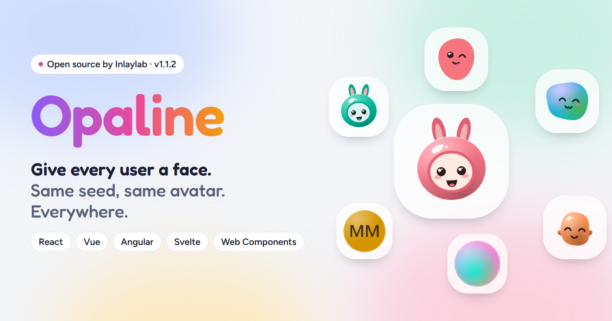
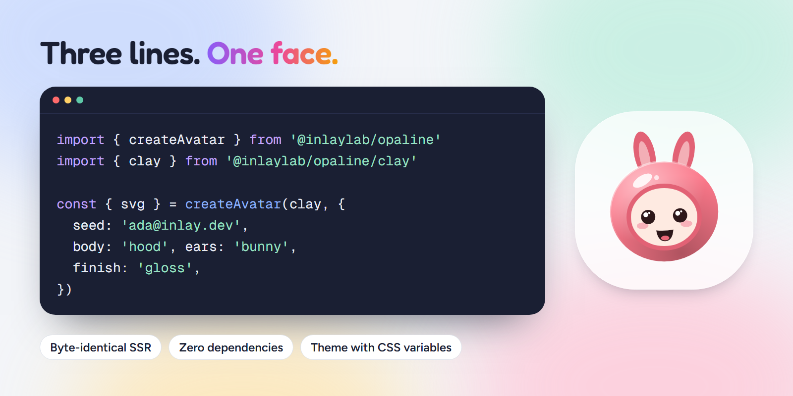
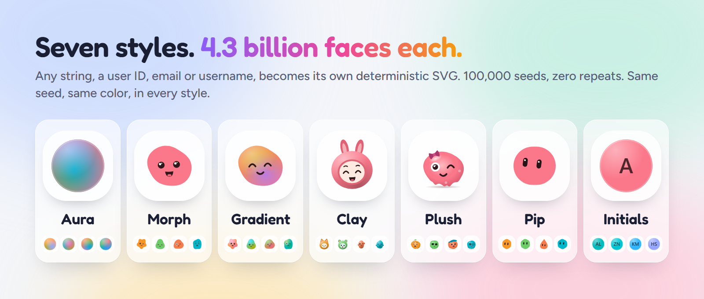
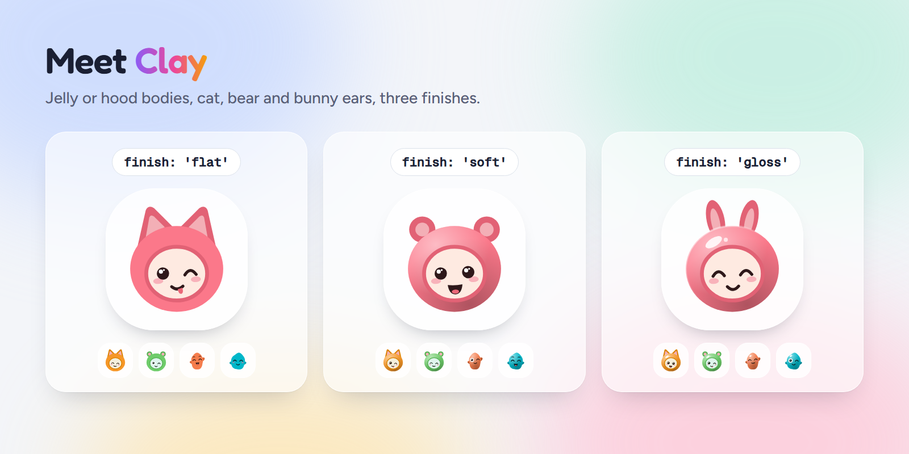

# Opaline for Angular: seeded avatars from end to end



Most users never upload a photo. This guide shows how to give each of them their own avatar in an Angular app, with standalone components, zoneless change detection and server-side rendering.

You will learn how to install Opaline, render your first avatar, pick a style, add photo fallback, build a team group, theme the colors and use it with Angular SSR.

**You need:** Angular 20 or later (`>=20.0.0 <23.0.0`). Node 22 or later for development.

## 1. Why avatars need a seed


The left side is what most apps ship. The right side is one input: `seed`.

- **Initials** collide. Two people are both "JS".
- **Random colors** change on every render unless you store them.
- **Generated avatars** that use `Math.random()` make the server render one face and the browser another.

Opaline has one input, the seed. The same seed and options always give the same SVG.

## 2. Install

```sh
npm i @inlaylab/opaline-angular
```

The package installs the core (`@inlaylab/opaline`) for you. Styles are separate imports from the core, so you only ship the ones you use.

## 3. Your first avatar

The component is standalone. Import `OpalineAvatar` straight into your component. No `NgModule` is needed.

```ts
import { Component, input } from '@angular/core'
import { OpalineAvatar } from '@inlaylab/opaline-angular'
import { clay } from '@inlaylab/opaline/clay'

@Component({
  selector: 'app-user-avatar',
  imports: [OpalineAvatar],
  template: `<op-avatar [seed]="email()" [look]="clay" [alt]="name()" />`,
})
export class UserAvatar {
  protected readonly clay = clay
  readonly email = input.required<string>()
  readonly name = input.required<string>()
}
```



Inputs:

| Input       | What it does                                                         |
| ----------- | -------------------------------------------------------------------- |
| `seed`      | The string that decides the avatar. Use a stable ID or email.        |
| `look`      | The style object: `aura`, `morph`, `gradient`, `clay`, `plush`, `pip` or `initials`. |
| `size`      | Width and height in pixels.                                          |
| `src`       | A photo URL. See [photo fallback](#6-photo-fallback).                |
| `alt`       | The accessible name. With `alt` the avatar is `role="img"`. Without it, the avatar is hidden from assistive tech. |
| others      | `palette`, `finish`, `expression`, `mood`, `face`, `family`, `backdrop`, `shape`, `body`, `ears`, `text`, `accessory` and `form`. |

Use the user ID rather than an email if people can change their email. Changing the seed changes the face.

## 4. Choose a style



Style objects are plain values. Expose them as class fields so the template can bind them:

```ts
import { aura } from '@inlaylab/opaline/aura'
import { morph } from '@inlaylab/opaline/morph'
import { gradient } from '@inlaylab/opaline/gradient'
import { clay } from '@inlaylab/opaline/clay'
import { initials } from '@inlaylab/opaline/initials'

export class Demo {
  protected readonly aura = aura
  protected readonly initials = initials
}
```

```html
<op-avatar [seed]="id" [look]="aura" />
<op-avatar [seed]="id" [look]="initials" />
```

| Style    | Looks like                                    |
| -------- | --------------------------------------------- |
| Aura     | A glowing orb of blended color                |
| Morph    | An organic blob with a face                   |
| Gradient | Smooth shapes with expressive faces           |
| Clay     | Small characters with jelly or hood bodies    |
| Plush    | Gummy critters with a seeded accessory         |
| Pip      | Geometric shapes with two pill eyes           |
| Initials | Letters from the seed on a seeded tile        |

## 5. Customize Clay and Initials

### Clay finishes, bodies and ears



```html
<op-avatar [seed]="id" [look]="clay" body="hood" ears="bunny" finish="gloss" />
```

- `body`: `jelly` or `hood`
- `ears`: `cat`, `bear` or `bunny` (hood only)
- `finish`: `flat`, `soft` or `gloss`

Any option you set fixes that part. The seed fills in everything else.

### Initials and shapes


```html
<op-avatar seed="ada.lovelace@inlay.dev" [look]="initials" shape="squircle" />
<op-avatar [seed]="user.id" [look]="initials" text="Op" palette="pastel" />
```

Letters come from the seed: `Zoë Nguyễn` gives ZN. Set `text` for your own, up to 3 characters. Every script works, and the letters clear WCAG AA (4.5:1) contrast.

Every style accepts `shape`: `circle`, `squircle` or `square`.

## 6. Photo fallback

```html
<op-avatar [seed]="user.email" [look]="clay" [src]="user.photo" [alt]="user.name" />
```

The generated avatar shows first. When the photo loads, it replaces the avatar. If the photo fails, the generated avatar stays. You never get a broken image icon.

## 7. Avatar groups

```ts
import { OpalineAvatarGroup } from '@inlaylab/opaline-angular'

@Component({
  selector: 'app-team',
  imports: [OpalineAvatarGroup],
  template: `<op-avatar-group [members]="people" [look]="clay" max="4" alt="Project members" />`,
})
export class Team {
  protected readonly clay = clay
  protected readonly people = [
    'ada@inlay.dev',
    { seed: 'grace@inlay.dev', src: '/grace.jpg', alt: 'Grace' },
    'linus@inlay.dev',
    'margaret@inlay.dev',
    'alan@inlay.dev',
  ]
}
```

Members are seeds, or `{ seed, src, alt }`. Past `max`, a `+N` chip shows the rest. Avatars default to 40px. The group takes `members`, `look`, `max`, `size`, `alt`, `palette`, `shape` and `finish`.

## 8. Theme with CSS variables

Colors are CSS variables, so a parent element can restyle every avatar below it.

```css
.team {
  --avatar-c1: #7c3aed; /* the body */
  --avatar-ring: #0b0b14; /* ring between grouped avatars: your background */
  --avatar-more-bg: #1f1f2e; /* the +N chip */
  --avatar-more-fg: #e5e5f0;
}
```

For Initials, `--avatar-fg` sets the letter color. For Clay, `--avatar-c2` is the arms and ears, and `--avatar-c3` is the hood opening.

## 9. Zoneless and Angular SSR


The components work zoneless and with SSR hydration. This is the configuration the repo's `apps/ssr-angular` sample uses:

```ts
// app.config.ts
import { provideZonelessChangeDetection, type ApplicationConfig } from '@angular/core'
import { provideClientHydration } from '@angular/platform-browser'

export const appConfig: ApplicationConfig = {
  providers: [provideZonelessChangeDetection(), provideClientHydration()],
}
```

```ts
// app.config.server.ts
import { mergeApplicationConfig } from '@angular/core'
import { provideServerRendering, withRoutes, RenderMode } from '@angular/ssr'
import { appConfig } from './app.config'

export const serverConfig = mergeApplicationConfig(appConfig, {
  providers: [provideServerRendering(withRoutes([{ path: '**', renderMode: RenderMode.Server }]))],
})
```

The sample renders two avatars on the server and checks in a browser that hydration changes nothing. The same seed gives the same bytes on the server, in every browser and in every 1.x release.

## 10. Export a PNG

For profile uploads, social cards or push notifications that refuse SVG:

```ts
import { createAvatar } from '@inlaylab/opaline'
import { clay } from '@inlaylab/opaline/clay'
import { toPng } from '@inlaylab/opaline/png'

const blob = await toPng(createAvatar(clay, { seed: user.email }), { size: 512 })
```

`toPng` runs in the browser with no dependencies. On the server, bake the colors in with `forRaster` and use a rasterizer such as `@resvg/resvg-js`:

```ts
import { forRaster } from '@inlaylab/opaline/png'

const png = new Resvg(forRaster(createAvatar(clay, { seed }), { size: 512 })).render().asPng()
```

## 11. Full example: a team list

```ts
import { Component, computed, input } from '@angular/core'
import { OpalineAvatar, OpalineAvatarGroup } from '@inlaylab/opaline-angular'
import { clay } from '@inlaylab/opaline/clay'

type Member = { id: string; name: string; photo?: string }

@Component({
  selector: 'app-team-list',
  imports: [OpalineAvatar, OpalineAvatarGroup],
  template: `
    <op-avatar-group [members]="group()" [look]="clay" max="4" alt="Team" />
    <ul>
      @for (m of members(); track m.id) {
        <li>
          <op-avatar [seed]="m.id" [look]="clay" [src]="m.photo" [alt]="m.name" [size]="32" />
          {{ m.name }}
        </li>
      }
    </ul>
  `,
})
export class TeamList {
  protected readonly clay = clay
  readonly members = input.required<Member[]>()
  protected readonly group = computed(() =>
    this.members().map((m) => ({ seed: m.id, src: m.photo, alt: m.name })),
  )
}
```

## Troubleshooting

| Problem | Fix |
| ------- | --- |
| Peer dependency error on install | The package supports Angular `>=20.0.0 <23.0.0`. |
| `look` binding is undefined | Style objects must be class fields. Templates cannot read imports directly. |
| Avatar changed after a user edited their email | Seed with a stable user ID. |
| Photo never shows | Check `src` loads in the network tab. A failed photo keeps the generated avatar on purpose. |

## Next steps

- Try every setting in the [playground](https://inlaylab.github.io/Opaline/playground/) and copy the Angular code.
- Read the [package README](../../packages/angular/README.md).
- Compare with other libraries on the [compare page](https://inlaylab.github.io/Opaline/compare/).

MIT for code and art.
