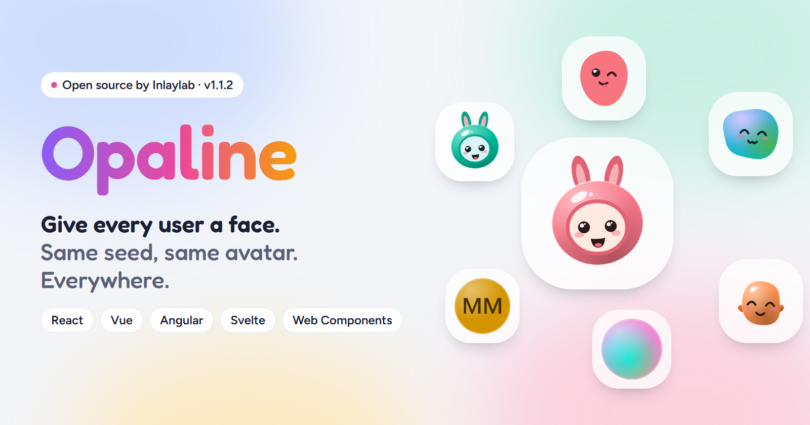
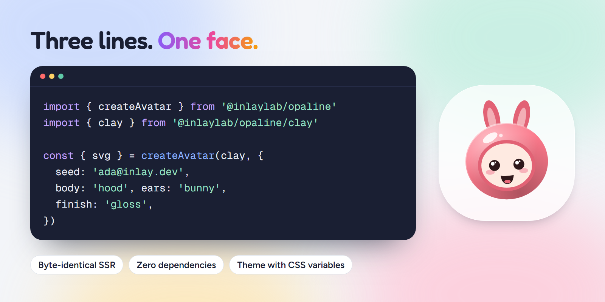
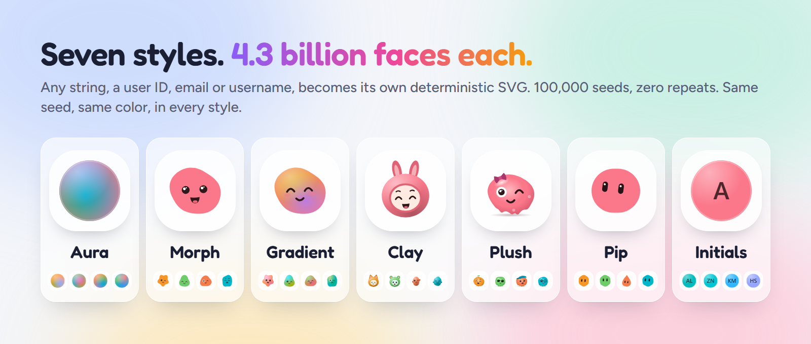
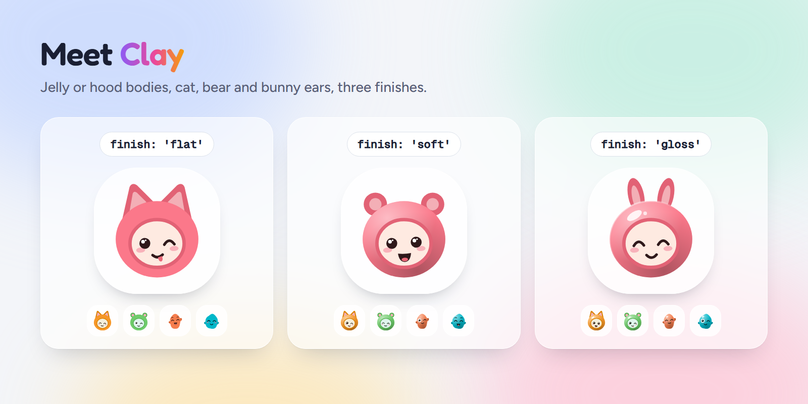

# Opaline for React: seeded avatars from end to end



Most users never upload a photo. This guide shows how to give each of them their own avatar in a React app, with no hydration warnings and no extra state.

You will learn how to install Opaline, render your first avatar, pick a style, add photo fallback, build a team group, theme the colors and use it in Next.js Server Components.

**You need:** React 18 or later. Node 22 or later for development.

## 1. Why avatars need a seed


The left side is what most apps ship. The right side is one prop: `seed`.

- **Initials** collide. Two people are both "JS".
- **Random colors** change on every render unless you store them.
- **Generated avatars** that use `Math.random()` make the server render one face and the browser another. React then logs a hydration warning.

Opaline has one input, the seed. The same seed and options always give the same SVG.

## 2. Install

```sh
npm i @inlaylab/opaline-react
```

The package installs the core (`@inlaylab/opaline`) for you. Styles are separate imports from the core, so you only ship the ones you use.

## 3. Your first avatar

```tsx
import { Avatar } from '@inlaylab/opaline-react'
import { clay } from '@inlaylab/opaline/clay'

export function UserAvatar({ user }: { user: { email: string; name: string } }) {
  return <Avatar seed={user.email} look={clay} alt={user.name} />
}
```



Props:

| Prop        | What it does                                                         |
| ----------- | -------------------------------------------------------------------- |
| `seed`      | The string that decides the avatar. Use a stable ID or email.        |
| `look`      | The style object: `aura`, `morph`, `gradient`, `clay`, `plush`, `pip` or `initials`. |
| `size`      | Width and height in pixels.                                          |
| `src`       | A photo URL. See [photo fallback](#6-photo-fallback).                |
| `alt`       | The accessible name. With `alt` the avatar is `role="img"`. Without it, the avatar is hidden from assistive tech. |
| other props | Every core option: `palette`, `shape`, `finish`, `expression`, `body`, `ears`, `text`, `accessory`, `form` and more. |

Use the user ID rather than an email if people can change their email. Changing the seed changes the face.

## 4. Choose a style



```tsx
import { aura } from '@inlaylab/opaline/aura'
import { morph } from '@inlaylab/opaline/morph'
import { gradient } from '@inlaylab/opaline/gradient'
import { clay } from '@inlaylab/opaline/clay'
import { initials } from '@inlaylab/opaline/initials'

<Avatar seed={id} look={aura} />
<Avatar seed={id} look={initials} />
```

| Style    | Looks like                                    |
| -------- | --------------------------------------------- |
| Aura     | A glowing orb of blended color                |
| Morph    | An organic blob with a face                   |
| Gradient | Smooth shapes with expressive faces           |
| Clay     | Small characters with jelly or hood bodies    |
| Plush    | Gummy critters with a seeded accessory         |
| Pip      | Geometric shapes with two pill eyes           |
| Initials | Letters from the seed on a seeded tile        |

## 5. Customize Clay and Initials

### Clay finishes, bodies and ears



```tsx
<Avatar seed={id} look={clay} body="hood" ears="bunny" finish="gloss" />
```

- `body`: `jelly` or `hood`
- `ears`: `cat`, `bear` or `bunny` (hood only)
- `finish`: `flat`, `soft` or `gloss`

Any option you set fixes that part. The seed fills in everything else.

### Initials and shapes


```tsx
<Avatar seed="ada.lovelace@inlay.dev" look={initials} shape="squircle" /> {/* AL */}
<Avatar seed={user.id} look={initials} text="Op" palette="pastel" />
```

Letters come from the seed: `Zoë Nguyễn` gives ZN. Set `text` for your own, up to 3 characters. Every script works, and the letters clear WCAG AA (4.5:1) contrast.

Every style accepts `shape`: `circle`, `squircle` or `square`.

## 6. Photo fallback

```tsx
<Avatar seed={user.email} look={clay} src={user.photo} alt={user.name} />
```

The generated avatar shows first. When the photo loads, it replaces the avatar. If the photo fails, the generated avatar stays. You never get a broken image icon.

## 7. Avatar groups

```tsx
import { AvatarGroup } from '@inlaylab/opaline-react'

<AvatarGroup
  look={clay}
  members={[
    'ada@inlay.dev',
    { seed: 'grace@inlay.dev', src: '/grace.jpg', alt: 'Grace' },
    'linus@inlay.dev',
    'margaret@inlay.dev',
    'alan@inlay.dev',
  ]}
  max={4}
  alt="Project members"
/>
```

Members are seeds, or `{ seed, src, alt }`. Past `max`, a `+N` chip shows the rest. Avatars default to 40px. `AvatarGroup` is server-safe too.

## 8. Theme with CSS variables

Colors are CSS variables, so a parent element can restyle every avatar below it.

```css
.team {
  --avatar-c1: #7c3aed; /* the body */
  --avatar-ring: #0b0b14; /* ring between grouped avatars: your background */
  --avatar-more-bg: #1f1f2e; /* the +N chip */
  --avatar-more-fg: #e5e5f0;
}
```

For Initials, `--avatar-fg` sets the letter color. For Clay, `--avatar-c2` is the arms and ears, and `--avatar-c3` is the hood opening.

## 9. Server Components and Next.js


`Avatar` is safe in a React Server Component. Only the optional photo part ships client code, so a page without `src` ships no avatar JavaScript at all.

```tsx
// app/page.tsx: a server component, no "use client" needed
import { gradient } from '@inlaylab/opaline/gradient'
import { Avatar } from '@inlaylab/opaline-react'

export default function Page() {
  return (
    <main>
      <Avatar seed="ada@inlay.dev" look={gradient} src="/ada.jpg" alt="Ada" />
      <Avatar seed="ada@inlay.dev" look={gradient} />
    </main>
  )
}
```

The repo's `apps/ssr-next` sample does exactly this and checks in a browser that hydration changes nothing. The same seed gives the same bytes on the server, in every browser and in every 1.x release.

## 10. Export a PNG

For profile uploads, social cards or push notifications that refuse SVG:

```ts
import { createAvatar } from '@inlaylab/opaline'
import { clay } from '@inlaylab/opaline/clay'
import { toPng } from '@inlaylab/opaline/png'

const blob = await toPng(createAvatar(clay, { seed: user.email }), { size: 512 })
```

`toPng` runs in the browser with no dependencies. On the server, bake the colors in with `forRaster` and use a rasterizer such as `@resvg/resvg-js`:

```ts
import { forRaster } from '@inlaylab/opaline/png'

const png = new Resvg(forRaster(createAvatar(clay, { seed }), { size: 512 })).render().asPng()
```

## 11. Full example: a team list

```tsx
import { Avatar, AvatarGroup } from '@inlaylab/opaline-react'
import { clay } from '@inlaylab/opaline/clay'

type Member = { id: string; name: string; photo?: string }

export function Team({ members }: { members: Member[] }) {
  return (
    <section>
      <AvatarGroup
        look={clay}
        max={4}
        alt="Team"
        members={members.map((m) => ({ seed: m.id, src: m.photo, alt: m.name }))}
      />
      <ul>
        {members.map((m) => (
          <li key={m.id}>
            <Avatar seed={m.id} look={clay} src={m.photo} alt={m.name} size={32} />
            {m.name}
          </li>
        ))}
      </ul>
    </section>
  )
}
```

## Troubleshooting

| Problem | Fix |
| ------- | --- |
| Avatar changed after a user edited their email | Seed with a stable user ID. |
| Photo never shows | Check `src` loads in the network tab. A failed photo keeps the generated avatar on purpose. |
| Avatar group ring looks wrong on a dark page | Set `--avatar-ring` to your page background. |
| The avatar is announced twice by a screen reader | Pass `alt` only when the name is not already in the text next to it. Leave it out for decorative avatars. |

## Next steps

- Try every setting in the [playground](https://inlaylab.github.io/Opaline/playground/) and copy the React code.
- Read the [package README](../../packages/react/README.md).
- Compare with other libraries on the [compare page](https://inlaylab.github.io/Opaline/compare/).

MIT for code and art.
