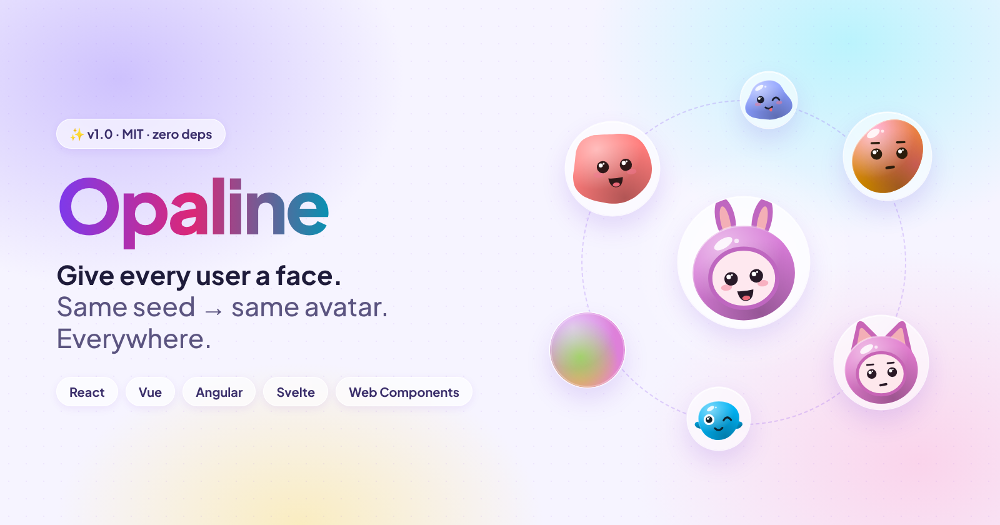
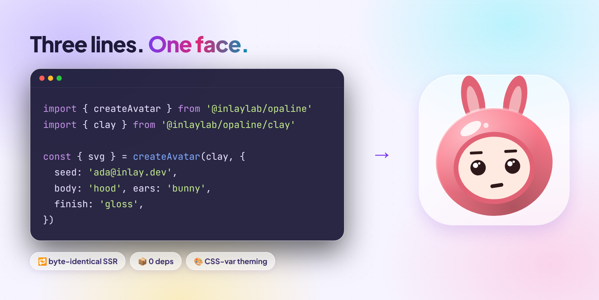
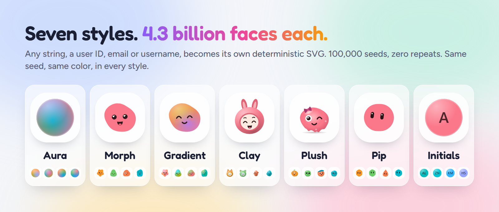
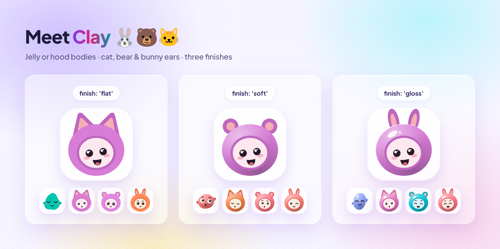

# Opaline for Web Components: seeded avatars with no framework



Most users never upload a photo. This guide shows how to give each of them a unique avatar with one custom element, `<opaline-avatar>`. It works in plain HTML, a server-rendered template, a CMS or any framework.

You will learn how to install Opaline, add your first avatar, pick a style, add photo fallback, build a team group and theme the colors.

**You need:** a modern browser. Node 22 or later if you use a bundler.

## 1. Why avatars need a seed


The left side is what most apps ship. The right side is one attribute: `seed`.

- **Initials** collide. Two people are both "JS".
- **Random colors** change on every render unless you store them.
- **Generated avatars** that use `Math.random()` give a different face on every load.

Opaline has one input, the seed. The same seed and options always give the same SVG.

## 2. Install

```sh
npm i @inlaylab/opaline-element
```

Import it once. Importing registers the `<opaline-avatar>` and `<opaline-avatar-group>` elements.

```html
<script type="module">
  import '@inlaylab/opaline-element'
</script>
```

With a bundler, put `import '@inlaylab/opaline-element'` in your entry file.

## 3. Your first avatar

```html
<opaline-avatar
  seed="ada@inlay.dev"
  look="clay"
  finish="gloss"
  size="64"
  alt="Ada"
></opaline-avatar>
```



Attributes:

| Attribute | What it does                                                         |
| --------- | -------------------------------------------------------------------- |
| `seed`    | The string that decides the avatar. Use a stable ID or email.        |
| `look`    | The style name: `aura`, `morph`, `gradient`, `clay` or `initials`.   |
| `size`    | Width and height in pixels.                                          |
| `src`     | A photo URL. See [photo fallback](#6-photo-fallback).                |
| `alt`     | The accessible name. With `alt` the avatar is `role="img"`. Without it, the avatar is hidden from assistive tech. |
| others    | `palette`, `finish`, `expression`, `mood`, `face`, `family`, `backdrop`, `shape`, `body`, `ears` and `text`. |

Use the user ID rather than an email if people can change their email. Changing the seed changes the face.

Here `look` is a name, not an object, so there is nothing else to import.

## 4. Choose a style



```html
<opaline-avatar seed="ada@inlay.dev" look="aura"></opaline-avatar>
<opaline-avatar seed="ada@inlay.dev" look="morph"></opaline-avatar>
<opaline-avatar seed="ada@inlay.dev" look="gradient"></opaline-avatar>
<opaline-avatar seed="ada@inlay.dev" look="clay"></opaline-avatar>
<opaline-avatar seed="ada@inlay.dev" look="initials"></opaline-avatar>
```

| Style    | Looks like                                    |
| -------- | --------------------------------------------- |
| Aura     | A glowing orb of blended color                |
| Morph    | An organic blob with a face                   |
| Gradient | Smooth shapes with expressive faces           |
| Clay     | Small characters with jelly or hood bodies    |
| Initials | Letters from the seed on a seeded tile        |

## 5. Customize Clay and Initials

### Clay finishes, bodies and ears



```html
<opaline-avatar seed="ada@inlay.dev" look="clay" body="hood" ears="bunny" finish="gloss"></opaline-avatar>
```

- `body`: `jelly` or `hood`
- `ears`: `cat`, `bear` or `bunny` (hood only)
- `finish`: `flat`, `soft` or `gloss`

Any attribute you set fixes that part. The seed fills in everything else.

### Initials and shapes


```html
<opaline-avatar seed="ada.lovelace@inlay.dev" look="initials" shape="squircle"></opaline-avatar>
<opaline-avatar seed="user-42" look="initials" text="Op" palette="pastel"></opaline-avatar>
```

Letters come from the seed: `Zoë Nguyễn` gives ZN. Set `text` for your own, up to 3 characters. Every script works, and the letters clear WCAG AA (4.5:1) contrast.

Every style accepts `shape`: `circle`, `squircle` or `square`.

## 6. Photo fallback

```html
<opaline-avatar seed="ada@inlay.dev" look="clay" src="/ada.jpg" alt="Ada"></opaline-avatar>
```

The generated avatar shows first. When the photo loads, it replaces the avatar. If the photo fails, the generated avatar stays. You never get a broken image icon.

## 7. Avatar groups

```html
<opaline-avatar-group look="clay" size="40" max="4" alt="Project members">
  <opaline-avatar seed="ada@inlay.dev" src="/ada.jpg" alt="Ada"></opaline-avatar>
  <opaline-avatar seed="grace@inlay.dev"></opaline-avatar>
  <opaline-avatar seed="linus@inlay.dev"></opaline-avatar>
  <opaline-avatar seed="margaret@inlay.dev"></opaline-avatar>
  <opaline-avatar seed="alan@inlay.dev"></opaline-avatar>
</opaline-avatar-group>
```

The group overlaps its children and shows a `+N` chip past `max`. Its `look`, `size`, `palette`, `shape` and `finish` are defaults for every child that does not set its own.

## 8. Theme with CSS variables

Colors are CSS variables, so any parent element, or your global stylesheet, can restyle every avatar.

```css
opaline-avatar-group {
  --avatar-c1: #7c3aed; /* the body */
  --avatar-ring: #0b0b14; /* ring between grouped avatars: your background */
  --avatar-more-bg: #1f1f2e; /* the +N chip */
  --avatar-more-fg: #e5e5f0;
}
```

For Initials, `--avatar-fg` sets the letter color. For Clay, `--avatar-c2` is the arms and ears, and `--avatar-c3` is the hood opening.

## 9. Use it from JavaScript

Create avatars from data in a script. Set attributes like on any element:

```js
const list = document.querySelector('#members')

for (const user of users) {
  const el = document.createElement('opaline-avatar')
  el.setAttribute('seed', user.id)
  el.setAttribute('look', 'clay')
  el.setAttribute('alt', user.name)
  list.append(el)
}
```

## 10. Need the SVG itself?


The element draws in the browser. If you need the avatar in server-rendered HTML, an email or a file, use the core package. The same seed gives the same bytes everywhere, in every 1.x release.

```ts
import { createAvatar } from '@inlaylab/opaline'
import { clay } from '@inlaylab/opaline/clay'

const { svg } = createAvatar(clay, { seed: 'ada@inlay.dev' })
```

`svg` is a plain string. Put it in HTML, save it as a file or send it in an email.

For places that take no SVG, such as profile uploads and push notifications, export a PNG:

```ts
import { toPng } from '@inlaylab/opaline/png'

const blob = await toPng(createAvatar(clay, { seed: 'ada@inlay.dev' }), { size: 512 })
```

## Troubleshooting

| Problem | Fix |
| ------- | --- |
| Nothing renders | Import `@inlaylab/opaline-element` once, before the element is used. |
| Avatar changed after a user edited their email | Seed with a stable user ID. |
| Photo never shows | Check `src` loads in the network tab. A failed photo keeps the generated avatar on purpose. |
| Avatar group ring looks wrong on a dark page | Set `--avatar-ring` to your page background. |

## Next steps

- Try every setting in the [playground](https://inlaylab.github.io/Opaline/playground/).
- Read the [package README](../../packages/element/README.md).
- Using a framework? See the [React](react.md), [Vue](vue.md), [Svelte](svelte.md) or [Angular](angular.md) guides.

MIT for code and art.
